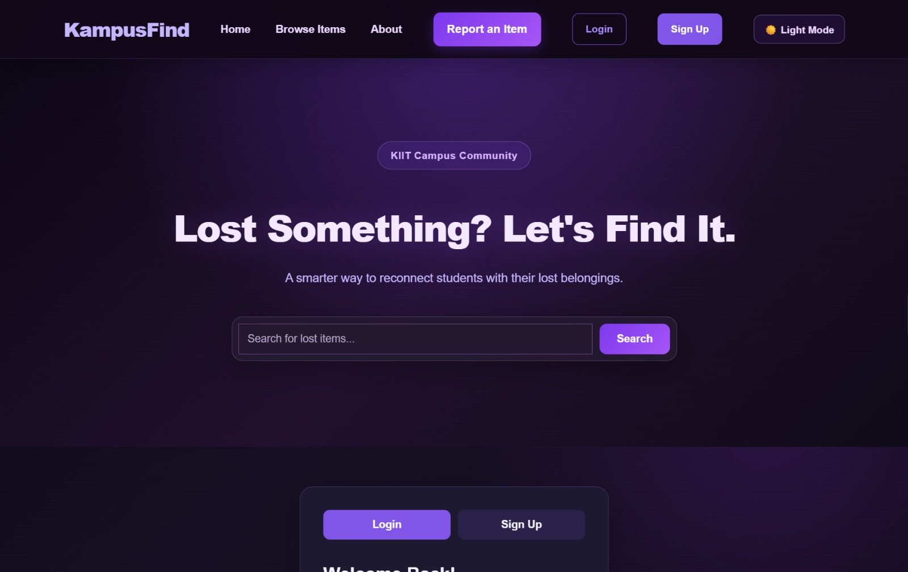
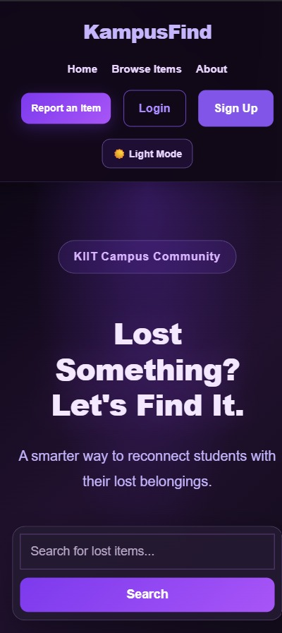

# KampusFind 🎓

A web-based Lost and Found platform designed to help college students reconnect with their lost belongings.

## 📌 Problem Statement

Students often struggle to find lost belongings because information is scattered across different communication channels, making it difficult to locate items or contact their owners.

## 💡 Proposed Solution

KampusFind provides a centralized platform where students can report lost and found items, browse listings, and manage their own reports.

## ✨ Features

- **User Authentication** – Sign up, login, logout, email confirmation, and password reset.
- **Report Items** – Create lost and found item listings.
- **Manage Listings** – Edit, delete, and mark your own listings as resolved.
- **Search & Filters** – Search by item name, category, location, and item type.
- **Combined Filters** – Apply multiple filters together.
- **User Ownership** – Manage only your own listings.
- **Database Persistence** – Listings remain available after refreshing the page.
- **Responsive Design** – Works across desktop, tablet, and mobile screens.
- **Dark & Light Mode** – Switch between two visual themes.
- **Notifications** – Get success and error messages for important actions.

## 🛠️ Tech Stack

| Technology   | Purpose                             |
| ------------ | ----------------------------------- |
| HTML         | Structure                           |
| CSS          | Styling and responsive design       |
| JavaScript   | Frontend functionality              |
| Supabase     | Authentication and backend services |
| PostgreSQL   | Database                            |
| Git & GitHub | Version control                     |
| Vercel       | Deployment                          |

## 🔐 Security

- Supabase Authentication manages user accounts.
- Row Level Security (RLS) protects item ownership.
- Users can insert, update, and delete only their own listings.
- Public item listings do not contain private contact details.

## 🚀 Getting Started

1. Clone this repository:

   git clone : https://github.com/2405214-hash/KampusFind.git

2. Open the project folder in VS Code.

3. Create a Supabase project.

4. Configure your Supabase project URL and publishable key in `js/app.js`.

5. Configure the required database table and RLS policies in Supabase.

6. Open the project using VS Code Live Server.

## 📂 Project Structure

KampusFind/
├── index.html
├── reset-password.html
├── css/
│ └── style.css
├── js/
│ ├── app.js
│ └── reset-password.js
├── assets/
├── README.md
└── .gitignore

## 🌐 Live Demo

[Visit KampusFind](https://kampusfind-eight.vercel.app/)

## 📸 Screenshots

### Desktop View

### Mobile View

## 📈 Project Status

**Core Features Implemented** ✅

The project is currently in its final testing and documentation stage.

## 👨‍💻 Author

Developed as a college student project.

---

⭐ If you find this project interesting, feel free to explore the repository!
